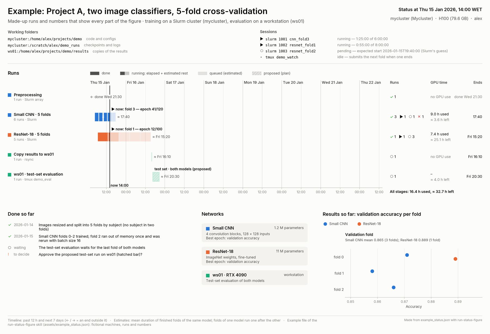
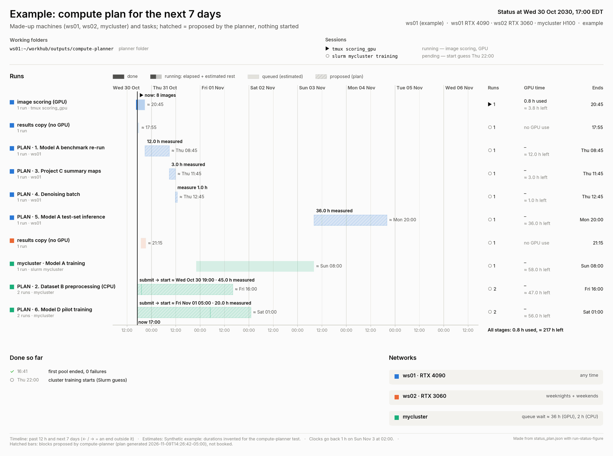

# Notion Work Hub with Claude (workhub-claude)

A Notion task hub that Claude Code keeps up to date with your conversations, machines and cluster jobs.
By **Walter Adame-Gonzalez** ([credit and license](#credit-and-license)).

## Quick start

About 10 minutes, once. You need [Claude Code](https://docs.claude.com/en/docs/claude-code) and a Notion account.

1. **Get the hub:** open the [Notion template](https://veiled-clementine-0d4.notion.site/Work-Hub-41371f09657181cfa7aaebd9631907bc)
   and click **Duplicate** (top right). You can also skip this: setup can build the hub for you.
2. **Install the skills** in Claude Code:
   ```
   /plugin marketplace add waadgo/workhub-claude
   /plugin install workhub-claude@workhub-claude
   ```
   (no plugins? see [Install](#install), option B). Then start a new Claude Code session.
3. **Set up:** say **`set up my work hub`**. It checks your machine, asks all its questions in one message
   (for Notion question B1 answer *existing* and paste the link of your copy), shows what it will do, and
   waits for your **`go`**. If the Notion connector is missing, it tells you the one command to add it.

**Every day**

| You want to | Do or say |
|---|---|
| note a new to-do | one line in the hub's 📥 Inbox (or "add to Inbox: …") |
| start working on a task | a new conversation: "new topic: …" or "continue WH-1" (the row's Task ID) |
| see what runs and when it ends | "status" |
| choose what to do next | "what should I work on?" |
| stop for the day | "wrap up for today" |
| Friday / Monday | "clean up my work hub" / "weekly recap", "plan my week" |

Everything below is detail.

## About

A personal task system in Notion that Claude Code keeps up to date with your real work: your conversations,
your workstations and your computing-cluster jobs. You jot to-dos in an Inbox; Claude files them, ranks them,
names each conversation after its task, keeps a short "topic card" on every active task, and marks a task Done
only after you confirm a short report of what was done and where the outputs are.

By **Walter Adame-Gonzalez** · code: Apache-2.0 · Notion template: CC BY 4.0 · please keep the credit
(see [Credit and license](#credit-and-license)).

## What you get

**The Notion Work Hub** (built for you by the setup skill, or copied from the
[published template](https://veiled-clementine-0d4.notion.site/Work-Hub-41371f09657181cfa7aaebd9631907bc) with "Duplicate"): an Inbox, and a
Tasks database with automatic Task IDs (`TK-42`), Status, Priority, Effort, Project, due dates, dependencies
(Blocked by / Blocks), an automatic **Score** (priority + deadline + what it unblocks, divided by effort) and
**Ready?** check, and eight views: Now, Focus, By project, Board, Blocked, Needs your call, Ideas, Done.

**Skills** (Claude Code; most also work in Codex):

| Skill | Say | What it does |
|---|---|---|
| `work-hub-setup` | "set up my work hub" | Asks every setup question once, then builds or connects the hub and installs everything. |
| `work-hub` | "file my inbox", "morning brief", "what should I work on?", "plan my week", "new topic: …" | Daily use: files the Inbox, writes the morning brief, plans and closes the week, one task per conversation, topic cards, Done reports. |
| `work-hub-cleanup` | "clean up my work hub" | Reads your recent conversations and jobs, asks evidence-based questions, then updates statuses, notes, due dates and dependencies. |
| `weekly-recap` | "weekly recap" | A recap of one finished week: tasks done and progressed, conversations, cluster usage, a timeline figure. |
| `run-status-figure` | "status", "what are my GPUs doing?" | A timeline figure (PNG + PDF) of what is done, running and queued, with end-time estimates. |
| `compute-planner` | "plan my compute for the week" | Proposes how to fill free GPU and CPU hours across your machines and clusters; starts nothing itself. |
| `research-log` | "log this in my research log" | Publishes figures, recaps and notes as pages of a Notion Research log. |
| `active-conversations` | "which conversations are open?" | Lists open or recent conversations across machines, and which can be closed. |
| `find-conversation` | "find the conversation where we …" | Finds a past conversation from what was done in it, and how to go back to it. |

**Hooks** that name each conversation `[Nov-04 09:10][ws01][UC] TK-42 Clean survey data` and remember its task.

**`cluster-login`**: one shared SSH login per computing cluster. You answer the password or two-factor prompt
once in your terminal; Claude can then read job queues through that login, and never types a password itself.

## What it looks like

Two of the figures the skills draw, made from the kit's fictional example files
([how](docs/images/HOW_MADE.md)):

**"status"** (run-status-figure): what is done, running and queued, with estimated end times, the folders and the
tmux sessions or Slurm jobs behind it.



**"plan my compute for the week"** (compute-planner): free GPU and CPU hours filled with your pending tasks by
rank; hatched bars are proposals, nothing starts until you say yes.



The Notion side: open the [published template](https://veiled-clementine-0d4.notion.site/Work-Hub-41371f09657181cfa7aaebd9631907bc).

## Requirements

- [Claude Code](https://docs.claude.com/en/docs/claude-code) and a Notion account with the **Notion
  connector** (in Claude Code: `claude mcp add --transport http notion https://mcp.notion.com/mcp`, then `/mcp`
  to log in; or connect Notion in claude.ai → Settings → Connectors).
- Python 3.8 or newer (3.9+ recommended). Figures need `matplotlib`.
- Optional: other workstations reachable over SSH, computing clusters with Slurm, Codex.

Nothing needs administrator rights; everything installs in your own folders.

## Install

**Option A: as a Claude Code plugin**

```
/plugin marketplace add waadgo/workhub-claude
/plugin install workhub-claude@workhub-claude
```

**Option B: by hand**

```bash
git clone https://github.com/waadgo/workhub-claude.git
cd workhub-claude
bash tools/install.sh            # shows what it would copy
bash tools/install.sh --apply    # copies the skills to ~/.claude/skills/ (add --codex for ~/.codex/skills/)
```

## Set up

Start Claude Code and say **"set up my work hub"**. The setup skill first checks your machine (time zone, CPUs,
GPUs, whether your home folder is shared with other machines), then asks **all** its questions in one message:

- **You:** first name (for notes), time zone.
- **Notion:** the link of the Notion page under which the hub should live (or the link of a hub you already
  copied from the [template](https://veiled-clementine-0d4.notion.site/Work-Hub-41371f09657181cfa7aaebd9631907bc)), the hub title, the Task ID prefix, your main projects, and whether you want a
  Research log and a Conversation reports database.
- **How you work:** conversation names, the rules block in `~/.claude/CLAUDE.md`, an optional orchestrator
  conversation, the morning brief (days, time, how it is scheduled), limits for the Now view.
- **Machines:** this machine, other workstations (CPUs, RAM, GPUs, usage rules such as "blocked Mon–Fri
  09:00–17:00"), and clusters (login host, user name, Slurm accounts).
- **cluster-login:** whether to install it and add `Host` blocks to `~/.ssh/config`.
- **Options of single skills**, each with a default.

It then shows everything it will create or change, waits for one **go**, does it all, verifies it, and reports.
Your answers are stored in one file, `~/.config/workhub-claude/config.json` (readable only by you); say
"set up my work hub" again to change any of them.

## Every day

- New to-do → one line in the hub's Inbox (or "add to Inbox: …").
- Start a task → a new conversation: "new topic: …" or "continue TK-42".
- "status" for a timeline of your runs; "what should I work on?"; "wrap up for today".
- Friday: "clean up my work hub"; Monday: "weekly recap" and "plan my week".

## Privacy

- The kit contains no personal data. Your settings, the conversation-name state and the indexes stay in your
  home folder (`~/.config/workhub-claude/`, `~/.local/state/workhub-claude/`), readable only by you.
- The skills write only to the Notion pages and databases you named. They read your conversation files and
  job queues on your own machines; remote machines are read only through an SSH login you opened yourself.
- Nothing is sent anywhere else. Claude never types passwords or two-factor codes.

## Uninstall

```bash
python3 ~/.local/share/workhub-claude/kit/skills/work-hub-setup/scripts/configure.py remove-rules --apply
python3 ~/.local/share/workhub-claude/kit/hooks/install_hooks.py --remove --apply
bash ~/.local/share/workhub-claude/kit/tools/install_cluster_login.sh --remove --apply
bash ~/.local/share/workhub-claude/kit/tools/install.sh --remove --apply     # option B only
rm -r ~/.config/workhub-claude                                                # your settings
```

(Plugin users run the same commands from the plugin folder, or uninstall the plugin with `/plugin`.) Your
Notion hub is never deleted.

## Credit and license

- **Code** (skills, scripts, hooks, tools): Apache License 2.0, see [LICENSE](LICENSE) and [NOTICE](NOTICE).
- **Notion Work Hub template** (layout, schema, formulas, views, page texts): CC BY 4.0, see
  [LICENSE-TEMPLATE.md](LICENSE-TEMPLATE.md). Keep the credit line at the top of the hub page.
- To cite: [CITATION.cff](CITATION.cff) (GitHub shows "Cite this repository").

Work Hub template and workhub-claude by Walter Adame-Gonzalez — https://github.com/waadgo/workhub-claude
